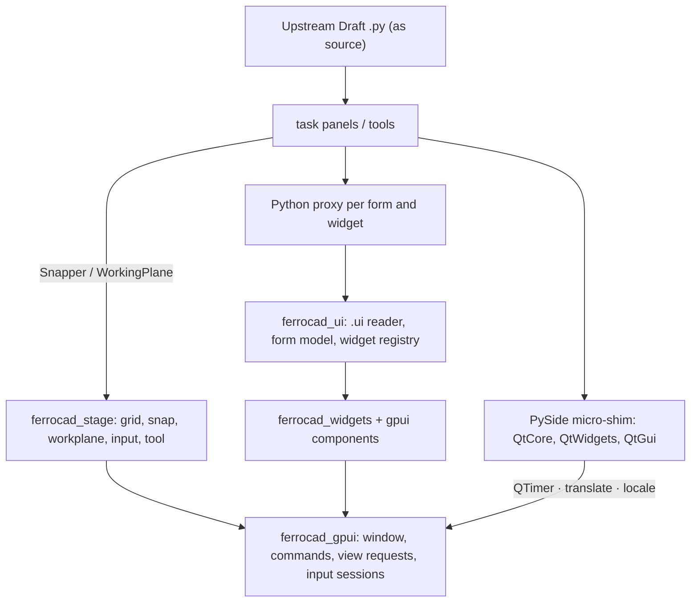

# Qt strategy: running upstream workbench GUIs

Status: design (2026-10-21; Q0–Q5 landed 2026-10-24).

**As built (2026-10-24).** Q0a–Q0d, Q1, Q2a/Q2b, Q3a/Q3b, Q4 and Q5 landed: Qt is
out of the headless paths, the `.ui` reader and `PySideUic` proxies exist, the gpui
shell hosts a rendered `FormDialog` with accept/reject, and the Draft tools run on a
native spatial reference. Q4 supplies `FreeCADGui.Snapper`/`draftToolBar`, the async
`getPoint` session, a native `PlaneGui`, the `Draft_Line`/`Draft_Wire` commands and
the checkable `Draft_Snap_*` bar; Q5 supplies the four remaining forms. The upstream
`gui_lines` path is still blocked by missing `ViewObject`/tracker surface, so the line
tools are a native `Creator`-shaped layer (see `qt-reduction.md` §3). The plan below
is the design record.

Choose how upstream PySide workbench GUIs — Draft first — reach FerroCAD's gpui shell.

Companion to [`rewrite-strategy.md`](../direction/rewrite-strategy.md) (the founding rules),
[`python-ui-research.md`](../interaction/python-ui-research.md) (Python-declarative, Rust-rendered UI),
[`input-components.md`](../interaction/input-components.md) (the widget model),
[`actions-and-tools.md`](actions-and-tools.md) (commands and the non-blocking modal),
[`visual-language.md`](../interaction/visual-language.md) (what the UI must look like),
[`toy-workbench.md`](toy-workbench.md) (the generic workbench seam),
[`app-shell-vision.md`](../direction/app-shell-vision.md) (the host), and
[`architecture.md`](../architecture.md) (the crate map).

---

## 0. Summary

**Recommendation: D — the split plane.** Keep upstream's UI *scripts* and `.ui` files as source,
but do not reproduce Qt. Three pieces carry the work:

1. the **native spatial reference** — grid, snap, workplane and pointer input already exist in
   `ferrocad_stage`, and `FreeCADGui.Snapper` / `WorkingPlane` route to them;
2. a **declarative `.ui` loader** — a Rust XML reader that recognises the 32 classes in the 19
   files (17 plain Qt, 15 `Gui::*`) and renders the subset the panels need onto
   `ferrocad_widgets`/gpui, handing Python a proxy (preferences and the tree view are deferred);
3. a **micro-shim** — exactly the methods and signals the panels call, with a loud failure for
   anything else.

The measurements support D because Draft's Qt use is *wide but shallow*: 117 files import PySide
and 74 Qt names appear, yet there are **4** Qt subclasses, **0** `paintEvent`s, **0**
`QGraphics*`/`QOpenGL*`, one delegate, and one model/view. The bulk of the surface is stock
widgets whose values are read and written. The deep work — grid, snap, workplane, point input —
is *not* Qt work, and already belongs to `ferrocad_stage`.

What D deliberately does not do: run `QWidget` subclasses, custom delegates, or `QPainter`;
support arbitrary PySide addons; or render preference pages in this phase.

---

## 1. Scope and method

All upstream numbers are measured on the sparse checkout at `freecad-upstream` @ **`33adf61`**
(2026-10-14), `src/Mod/Draft` (244 `.py` files, 76,988 lines). This checkout contains `src/Mod`
only — **not** `src/Gui` or `src/App` — so upstream C++ is not available to verify (see §7,
“What I could not verify”).

Counts were produced by:

- `grep`/`find` for imports, names and line counts;
- a Python **AST** pass over all 244 files for call sites (`connect`, `QTimer`, `QApplication`,
  `QObject.connect`);
- an `xml.etree` parse of the 19 `.ui` files for the widget inventory and properties;
- a regex pass over `self.form.<widget>.<member>(` and `self.dialog.<widget>.<member>(` in the
  10 `.ui`-backed modules for the contract table. This misses aliased access (none was found in
  these modules) and sees a signal use only in `X.sig.connect(...)` form;
- one headless **probe** (§2.6) using the repository's `python/` facade and a ~40-line `PySide`
  stub. It is a probe of the import chain, not a test suite.

Counts marked *estimate* are not measured.

---

## 2. What the tree actually needs

### 2.1 Import surface

| Measure | Value |
| --- | --- |
| `.py` files under `src/Mod/Draft` | 244 |
| Files importing PySide | **117** (48%) |
| Distinct Qt names used | **74** — `QtWidgets` 30, `QtGui` 23, `QtCore` 21 |
| `gui_*.py` tool modules | 65 |
| Registered commands (`addCommand`) | 86 |
| `.ui` files | 19 (all listed in `Resources/Draft.qrc`) |
| `PySideUic.loadUi` call sites | 11 |
| Panel modules | **7**: 6 load a `.ui` (5 small + `gui_setstyle`), `task_scale` builds widgets in code |
| GUI-bearing Python lines | ≈**40,500** (sum of `draftguitools` 20,674 + `draftviewproviders` 5,091 + `drafttaskpanels` 2,219 + `DraftGui`/`InitGui`/importers/`DraftTools`/`WorkingPlane` 12,533; not semantically de-duplicated) |

The 11 `loadUi` sites break down as: the 6 `.ui` panels, `drafttaskpanels/__init__.py`'s generic
loader (a documented example, not a live panel), and 4 dialog/editor modules —
`gui_annotationstyleeditor`, `gui_layers`, `gui_hatch`, `DxfImportDialog`.

### 2.2 The imperative surface is small

This is the crux of the argument against option B, so it is measured rather than asserted.

| Pattern | Count | Where / notes |
| --- | --- | --- |
| Classes subclassing a Qt class | **4** (no `QDialog` subclass) | `DraftBaseWidget(QWidget)`, `DraftLineEdit(QLineEdit)`, `_FieldLockFilter(QObject)`, `Layers_Delegate(QStyledItemDelegate)` |
| Event-handler overrides | **6** | `eventFilter` ×2, `resizeEvent`, `changeEvent` ×2, `keyPressEvent` |
| Delegate overrides | **3** | `createEditor` / `setEditorData` / `setModelData` (Layers) |
| `paintEvent` overrides | **0** | — |
| `QGraphics*` / `QOpenGL*` / `QOpenGLWidget` | **0** | — |
| `QPainter` sites (code) | **3** | icon generation: `DraftGui.setStyleButton`, `view_layer`, `snapper` cursor |
| `QTimer` call sites | **25**, in 11 modules | almost all `singleShot(0, …)` deferral; the rest are real delays (100/300/500 ms) |
| `QApplication` calls (AST) | **15** in 3 files — **6** in production | 4 `translate` (`DraftGui`), 2 `activeWindow` (annotation editor), 9 `processEvents`/`sendEvent` in `drafttests` |
| `QSettings` | **0** | — |
| Attribute-style signal connections | **142** | 18 distinct signal names; `clicked` 46, `checkStateChanged` 18, `stateChanged` 18, `valueChanged` 13 |
| Legacy `QObject.connect(QtCore.SIGNAL(...))` | **16**, in 7 modules | 21 `QtCore.SIGNAL(...)` literals in code; 9 connects in `task_scale`, 7 for `QAction.triggered` in view providers/tools |
| Custom item models | **1** | `QStandardItemModel` in the Layers dialog |
| `QTreeView` | **1** | Layers dialog |
| `QTabWidget` | **1** | `TaskPanel_SetStyle.ui` (static pages, never touched from Python) |
| `QFontComboBox` | **2** | SetStyle, AnnotationStyleEditor |
| Nested `exec_()` loops | **7** | annotation editor, Layers, Dxf import, DXF import ×2, SVG import, hyperlink |
| `QMainWindow` lookups (`getMainWindow`) | 19 | status bar, cursor position, MDI child lookups |
| `QMenu` / `QToolBar` | 3 / 12 | view-provider context menus, the Draft tray |
| `QMessageBox` / `QInputDialog` / `QFileDialog` / `QColorDialog` | 36 / 7 / 2 / 3 | mostly in dialogs, importers and error paths |

There is **no** custom painting, no `QGraphicsScene`, no widget-embedded GL and no settings
store. A `QWidget` is used to draw a stock control and to be read back. That is the whole
imperative model the loader must reproduce.

### 2.3 The `.ui` inventory

495 widgets in 19 files, **32 distinct classes** (17 plain Qt, 15 `Gui::*`). The per-class
counts below sum to 495.

**Plain Qt (17 classes, 326 instances):**

| Class | n | Class | n | Class | n |
| --- | ---: | --- | ---: | --- | ---: |
| `QLabel` | 170 | `QGroupBox` | 42 | `QPushButton` | 30 |
| `QWidget` | 19 | `QSpinBox` | 16 | `QCheckBox` | 13 |
| `QComboBox` | 9 | `QRadioButton` | 7 | `QDoubleSpinBox` | 6 |
| `QDialog` | 3 | `QLineEdit` | 3 | `QFontComboBox` | 2 |
| `QDialogButtonBox` | 2 | `QScrollArea` | 1 | `QFrame` | 1 |
| `QTreeView` | 1 | `QTabWidget` | 1 | | |

**FerroCAD-relevant upstream custom widgets (15 classes, 169 instances):**

| Class | n | Used by | Scope |
| --- | ---: | --- | --- |
| `Gui::PrefCheckBox` | 42 | preference pages | deferred |
| `Gui::PrefLineEdit` | 29 | preference pages | deferred |
| `Gui::InputField` | 24 | task panels | **required** |
| `Gui::QuantitySpinBox` | 14 | task panels | **required** |
| `Gui::ColorButton` | 11 | task panels, SetStyle | **required** |
| `Gui::PrefComboBox` | 10 | preference pages | deferred |
| `Gui::PrefSpinBox` | 10 | preference pages | deferred |
| `Gui::PrefDoubleSpinBox` | 7 | preference pages | deferred |
| `Gui::PrefUnitSpinBox` | 7 | preference pages | deferred |
| `Gui::PrefColorButton` | 5 | preference pages | deferred |
| `Gui::PrefRadioButton` | 4 | preference pages | deferred |
| `Gui::FileChooser` | 2 | ShapeString, Hatch | **required** |
| `Gui::PrefFileChooser` | 2 | preference pages | deferred |
| `Gui::PrefFontBox` | 1 | preference pages | deferred |
| `Gui::PrefQuantitySpinBox` | 1 | preference pages | deferred |

The split is decisive: **all 118 `Gui::Pref*` instances live in the 9 `preferences-*.ui`
files**; the task panels and dialogs use only **four** custom classes (51 instances). The
custom-widget registry can therefore be honest about a small required set and leave preferences
to a later native settings UI.

### 2.4 The form contract

Measured per module first, so each of the seven panel modules is accounted for. “Members” counts
distinct method/signal names; “calls” counts every occurrence (a panel may call `.isChecked()`
twice on one checkbox).

| Module | Form | Widgets | Distinct members | Calls |
| --- | --- | ---: | ---: | ---: |
| `task_orthoarray.py` | `TaskPanel_OrthoArray.ui` | 39 | 14 | 72 |
| `task_polararray.py` | `TaskPanel_PolarArray.ui` | 15 | 12 | 45 |
| `task_circulararray.py` | `TaskPanel_CircularArray.ui` | 19 | 12 | 49 |
| `task_shapestring.py` | `TaskShapeString.ui` | 15 | 10 | 22 |
| `task_selectplane.py` | `TaskSelectPlane.ui` | 26 | 0 | 0 |
| `gui_setstyle.py` | `TaskPanel_SetStyle.ui` | 72 | 18 | 158 |
| `task_scale.py` | none — built in code | 12 constructed | 12 | 3 signals |
| `gui_hatch.py` (dialog) | `dialogHatch.ui` | 11 | 13 | 27 |
| `gui_layers.py` (dialog) | `dialogLayers.ui` | 9 | 12 | 27 |
| `gui_annotationstyleeditor.py` (dialog) | `dialog_AnnotationStyleEditor.ui` | 53 | 15 | 39 |
| `DxfImportDialog.py` (dialog) | `preferences-dxf-import.ui` | 11 | 7 | 28 |

Aggregated over the 10 `.ui` forms (270 widget instances), the contract is the table below.
`member` is a method unless shown in angle brackets, which denotes a signal.

| Member | Widget classes (uses) | Total |
| --- | --- | ---: |
| `setProperty` | `InputField` 36, `ColorButton` 16, `QuantitySpinBox` 7 | 59 |
| `text` | `InputField` 36, `QuantitySpinBox` 3, `QLineEdit` 3 | 42 |
| `setEnabled` | `InputField` 24, `QRadioButton` 8, `QPushButton` 4 | 36 |
| `value` | `QSpinBox` 21, `QDoubleSpinBox` 12 | 33 |
| `isChecked` | `QCheckBox` 19, `QRadioButton` 10, `QPushButton` 1 | 30 |
| `setText` | `InputField` 14, `QLabel` 9, `QLineEdit` 3, `QPushButton` 2 | 28 |
| `property` | `ColorButton` 24, `FileChooser` 3 | 27 |
| `<clicked>` | `QPushButton` 21, `QRadioButton` 3 | 24 |
| `setValue` | `QSpinBox` 16, `QDoubleSpinBox` 6 | 22 |
| `setChecked` | `QCheckBox` 10, `QRadioButton` 7, `QPushButton` 1 | 18 |
| `currentIndex` | `QComboBox` 16 | 16 |
| `setCurrentIndex` | `QComboBox` 14 | 14 |
| `setIcon` | `QPushButton` 14 | 14 |
| `itemText` | `QComboBox` 8 | 8 |
| `<checkStateChanged>` / `<stateChanged>` | `QCheckBox` 7 each | 14 |
| `selectAll` / `setFocus` | `InputField` 6 each | 12 |
| `show` | `QGroupBox` 2, `QLabel` 2 | 4 |
| `hide` | `QGroupBox` 3, `QLabel` 2 | 5 |
| `layout` | `QGroupBox` 2 | 2 |
| `setTitle` | `QGroupBox` 2 | 2 |
| `resize` / `sizeHint` | `QPushButton` 2 each | 4 |
| `currentText` / `addItem` / `currentFont` / `toggled` / `valueChanged` | `QComboBox`/`QComboBox`/`QFontComboBox`/`QRadioButton`/`QuantitySpinBox` | 4 / 3 / 3 / 4 / 4 |
| `addItems` / `clear` / `count` / `setCurrentText` / `setCurrentFont` | `QComboBox` (×4), `QFontComboBox` | 2 / 2 / 2 / 2 / 2 |
| `findText` / `removeItem` / `setItemText` | `QComboBox` | 1 each |
| `setFileName` / `<fileNameSelected>` / `<fileNameChanged>` | `FileChooser` | 2 / 1 / 1 |
| `<textEdited>` | `QLineEdit` | 1 |
| `<accepted>` | `QDialogButtonBox` | 1 |
| `<rejected>` | the form/dialog root | 1 |

**Deferred (Layers only):** `header` 1, `selectedIndexes` 3, `setColumnWidth` 2,
`setItemDelegate` 1, `setItemsExpandable` 1, `setModel` 1, `setRootIsDecorated` 1,
`setSelectionMode` 1, `setUniformRowHeights` 1.

For the six core panels alone (OrthoArray, PolarArray, CircularArray, ShapeString, SelectPlane,
SetStyle: 186 widgets) the contract is **24 methods, 312 calls, 7 signals, 34 connections**. The
dialogs add 84 widgets, 35 methods, 102 calls. This is the precise member surface; §4.4 adds the
layout escape hatch and the root form methods.

### 2.5 The one panel without a `.ui`

`task_scale.py` (275 lines) composes its form in code:

```python
self.form = QtWidgets.QWidget()
layout = QtWidgets.QGridLayout(self.form)
self.xValue = QtWidgets.QDoubleSpinBox()
self.xValue.setRange(...); self.xValue.setDecimals(...); self.xValue.setValue(1)
layout.addWidget(self.xValue, 0, 1, 1, 1)
QtCore.QObject.connect(self.xValue, QtCore.SIGNAL("valueChanged(double)"), self.setValue)
```

It uses 8 classes and 12 methods (`QWidget`, `QGridLayout.addWidget`, `QLabel.setText`,
`QDoubleSpinBox.{setRange,setDecimals,setValue,value,hasFocus}`,
`QCheckBox.{setText,setChecked,isChecked}`, `QPushButton.setText`, `QIcon`, `setWindowTitle`,
`setWindowIcon`). It cannot be loaded from a `.ui` file. D handles it in one of two ways, and
**prefers the first**:

1. convert it to `TaskPanel_Scale.ui` (a 6-widget grid) in the mod copy — a ~40-line patch, with
   the Python logic unchanged; or
2. let the micro-shim own the construction API (`QWidget`, `QGridLayout`, the four leaf
   widgets). This weakens the "declarative only" rule and is the fallback.

### 2.6 Why `DraftGui` dies today

The failure is a **resource-loading** failure, not a widget failure, and it happens before any
GUI decision matters.

- `draftutils/params.py` and `draftutils/translate.py` `import PySide.QtCore` /
  `PySide.QtWidgets` **unconditionally** at module load. The facade has no `PySide` alias, so
  `import DraftGui` fails at import.
- Even with a `PySide` module, `PARAM_DICT` is built by opening `:/ui/preferences-*.ui` through
  `QtCore.QFile` and parsing the `Gui::Pref*` widgets (118 of them). FerroCAD has no Qt resource
  system, so `QFile.open` fails and those entries never reach the dictionary.
- `DraftGui.DraftToolBar.__init__` reads `textheight` (default `3.5`) and `constructioncolor`;
  both are declared **only** in preference `.ui` files (`preferences-drafttexts.ui`,
  `preferences-draft.ui`) and are contributed to `PARAM_DICT` by parsing those files. The latter
  is fed straight into `rgba_to_argb` (`DraftGui.py:205`). With no resource system,
  `get_param("constructioncolor")` returns `None` and `rgba_to_argb(None)` raises `TypeError`.
  The probe measured `textheight -> None` with 43 entries; it did not isolate the exact crashing
  call.

Measured in the headless probe: with a non-reading `QFile` stub, `params` imports but exposes
**43** `Mod/Draft` entries and `textheight -> None`, `ScaleUniform -> False`; with a `QFile`
that serves `Resources/ui`, parsing advances past `QFile` and stops at a **core** gap —
`ParameterGrp` has no `GetStrings()` (used by `Gui::PrefFontBox`). A second core gap was
measured separately: `App.Units.Quantity(100.0, App.Units.Length)` raises
`TypeError: 'Unit' object cannot be converted to 'PyString'`, although
`Quantity(100.0, "mm")` works. In the same probe, `import draftobjects.rectangle` stopped on
the missing third-party `lazy_loader` package, which 10+ Draft modules import.

So HEAD is not a stable target *and* the App-level import chain is not Qt-free. Both facts shape
Q0.

---

## 3. The four options

### A. Bundle Qt, optionally render offscreen

**What it buys.** The highest drop-in compatibility: unmodified `QWidget` subclasses, delegates,
models, `QPainter`, native dialogs, and every one of the 117 PySide importers. No `.ui` rewrite,
no proxy.

**Measured cost on this machine.** PySide6 package **39.9 MiB**; `libQt6Core` + `Gui` +
`Widgets` **21.8 MiB**; Qt6 plugins **5.2 MiB** — ≈**67 MiB** uncompressed before translations,
fonts and icons. Offscreen rendering is real: with `QT_QPA_PLATFORM=offscreen`, `QWidget.grab()`
returned a 200×100 image with no display server (the platform warned that it does not support
`propagateSizeHints()`).

**Measured obstacles.** No `PySide` alias; no `PySide6.QtSvg`; no `PySide6.QtUiTools`
(`QUiLoader`); `pyside6-uic` is not on `PATH` (only the C++ `/usr/bin/uic`). Upstream's
`FreeCADGui.PySideUic.loadUiType` shells out to `pyside6-uic`, so A must ship that tool or a
loader anyway.

**Structural costs.**

- **Two event loops.** Qt wants a `QApplication` on the main thread and an event loop; gpui owns
  the loop. Pumping `QApplication.processEvents()` from gpui loses timers, tooltips, popups, IME
  and nested `exec_()` modals; a nested `exec_()` blocks the gpui frame. This is the conflict
  the strategy doc already flags. Offscreen rendering removes *windows* from the problem, not
  `QApplication`.
- **The `Gui::*` widgets do not come with Qt.** `Gui::InputField`, `QuantitySpinBox`,
  `ColorButton`, `FileChooser` and the 11 `Pref*` classes are FreeCAD C++ widgets. A either
  links upstream's `src/Gui` (which pulls the C++ `App`/`Base` world the rewrite exists to
  remove) or reimplements 15 classes — the same registry D needs.
- **The look.** Qt's style and QSS approximate the tokens in `visual-language.md` (colour roles)
  but cannot produce the glass, the snap aurora, the zero-modality pills, or "numbers never
  jump". An offscreen Qt texture inside a gpui window is a compatibility mode, not the product
  UI.
- **Maintenance.** A second UI toolkit, a Qt/PySide ABI pin, two styling systems, and two input
  models.

**Verdict.** Not a strawman: it is the cheapest route to *pixel-identical legacy UI* and the
only one that runs custom `QWidget` subclasses. It is not the route to FerroCAD's own UI, and it
does not remove the custom-widget work.

### B. Emulate PySide6 over gpui

Reference: `gpui-toolkit` (pierreaubert) — **unverified, external**; the network is unavailable,
so no claim is made about its coverage.

**What it buys.** One event loop, native gpui rendering, no Qt payload, and a compatibility
surface that could in principle serve other PySide workbenches too.

**What "emulate PySide6" must mean for Draft.** At minimum: `QObject` parenting and ownership,
signals/slots including the legacy string `SIGNAL("valueChanged(double)")`, event filters,
layouts and dynamic reparenting, `QWidget` subclass hooks (`resizeEvent`, `changeEvent`,
`keyPressEvent`), `QStyledItemDelegate` + `QStandardItemModel` + `QTreeView`,
`QIcon`/`QPixmap`/`QImage`, `QPainter` for three icon sites, `QAction`/`QMenu`/`QToolBar`,
native dialogs, and `exec_()`. That is the 74-name surface plus the semantics *behind* the 142
connections.

**Why it is the wrong unit.** A PySide emulation promises compatibility with code we have not
measured — upstream-wide, 519 files import PySide (per `rewrite-strategy.md`). Its scope is
"whatever an addon does", which is unbounded. And it still does not cover the 15 `Gui::*`
classes: those are FreeCAD classes, not PySide, so B needs the same custom-widget registry and
`.ui` loader as D, plus a Qt object model on top.

**Verdict.** B = D + a general Qt emulation layer + an open-ended compatibility promise. It is
the right choice only if the goal changes from "Draft works" to "arbitrary PySide addons work".
Its one real advantage over A — a single event loop — is already D's starting point.

### C. Rewrite Draft's GUI scripts against FerroCAD bindings

**Scope.** ≈40,500 lines of GUI-bearing Python (measured sum), 65 tools, 86 commands, 7 panels;
`DraftGui.py` alone is 2,340 lines and its `DraftToolBar` ~2,173. The geometry interaction is
another ≈5,600 lines (`gui_snapper` 1,800 + `gui_trackers` 1,762 + `WorkingPlane` 2,023).

**What it buys.** A UI designed for the visual language from the start; no shim, no legacy
semantics, no Qt names in the tree.

**What it costs.** Every upstream fix must be re-applied; other workbenches get no reuse; the
parts that already work (working-plane alignment math, array validation, snap algorithms) are
rewritten. It is the only option whose *first* deliverable is not a running upstream panel.

**Verdict.** Not the first move. D's Q4–Q5 effectively rewrite the presentation while keeping
the logic; C is what remains if the shim proves untenable.

### D. The split plane (recommended)

| Piece | Owner | Reuses |
| --- | --- | --- |
| grid, snap, workplane, point input | `ferrocad_stage` | new Rust, existing modules |
| `.ui` parsing, layout, widget tree, signals | new `ferrocad_ui` + `ferrocad_ui_py` | `ferrocad_widgets`, gpui |
| the 4 panel-relevant `Gui::*` classes | custom-widget registry in `ferrocad_ui` | `InputField` semantics, `Quantity` |
| Python compat: `PySide.QtCore/QtWidgets/QtGui` | micro-shim (Python + Rust dispatch) | `actions-and-tools.md` error policy |
| upstream panel/tool scripts and `.ui` files | `mods/Draft` (as source) | unchanged wherever possible |

### Comparison

| | A. bundle Qt | B. emulate PySide | C. rewrite | D. split plane |
| --- | --- | --- | --- | --- |
| Payload | ≈67 MiB + runtime | ~0 | ~0 | ~0 |
| Event loop | two; `exec_` blocks | one | one | one |
| Stock widgets work | yes | yes (if faithful) | n/a | yes, the measured subset |
| `Gui::*` work | 15 reimplementations *or* link C++ Gui | 15 reimplementations | rewrite | 15 registry entries (4 live) |
| `.ui` loader needed | yes (PySideUic/uic) | yes | no | yes |
| Upstream PySide code | unchanged | mostly unchanged | rewritten | unchanged, with a shim |
| Upstream updates | free | free-ish | re-apply | `.ui` and scripts, free |
| Visual language | approximated | native | native | native |
| First running panel | fastest if Qt present | slow | slowest | Q3 |
| Blast radius | Qt ABI + two loops | open-ended Qt semantics | 40k lines | measured 72 members |

---

## 4. D, specified

### 4.1 Layering



Two rules make the diagram true:

- Python never holds a gpui element. It holds a **proxy** whose methods mutate a Rust-side form
  model; the shell re-renders on a change notification, never per frame (`python-ui-research.md`
  §B).
- Python never holds a geometry. `Snapper` and `WorkingPlane` read and write `ferrocad_stage`
  values through PyO3 (`ferrocad_stage_py`), so the viewport and Python share one source of
  truth.

### 4.2 Native spatial reference

`ferrocad_stage` already contains the pieces:

| Module | Types / functions | Role |
| --- | --- | --- |
| `workplane.rs` | `Workplane { origin, u, v, n, kind }`, `WorkplaneKind::{World, Datum, Face}`, `FaceFrame` | the planar frame |
| `grid.rs` | `GridSpec { workplane, minor, major, radius }`, `GridStyle`, `build`/`ground`/`triad`, `effective_steps` | reference grid, workplane grid, triad |
| `snap.rs` | `SnapContext { workplane, minor, major }`, `SnapKind`, `Snap`, `snap_to_geometry_with`, `nearest_feature` | resolve the pointer |
| `input.rs` | `PointerEvent`, `PointerKind`, `MouseButton` | the structured pointer event |
| `interaction.rs` / `tool.rs` | `InteractionCommit`, `Manipulator`, `Tool`, `PolylineTool` | commits and tool sessions |
| `screen.rs` | projections, pixel tolerances | screen ↔ world |

`ferrocad_viewport` already owns an active workplane, two local grid layers, the origin node and
`snap_to_geometry_with`; `ferrocad_gpui::view` already carries the request
`ViewRequest { grid, axis_cross, projection, grid_minor, grid_major, grid_radius, workplane }`
and mirrors `ViewState` to the facade.

**Routing table.** “Status” describes the shell/stage capability, not a Python binding: no
`Snapper` or `PlaneGui` routing exists yet. `ferrocad_stage_py` does not export `Workplane`,
`SnapContext` or `Snap` (it exports camera, shape, stage, tool, gizmo and pointer events); Q4
adds them.

| Upstream call | Route | Status |
| --- | --- | --- |
| `Snapper.setGrid()` / `toggleGrid()` | `ViewRequest { grid }` → `ViewState` → viewport grid layers | shell supports (G5) |
| grid spacing/size/colour prefs | `GridSpec { minor, major, radius }` + `GridStyle` | shell supports |
| `Snapper.snap(...)` for Grid / Endpoint / Vertex / Midpoint / Center / Origin | `SnapContext.snap_point` (world-space) over `snap_to_geometry_with` (screen-space) | **done** (Q4) |
| `Snapper` modes Extension, Parallel, Perpendicular, Intersection, Angle, Special, Dimensions, Ortho, Lock | no native equivalent (only 6 `SnapKind`s vs 15 Draft modes) | deferred; the proxy raises |
| `Snapper.getPoint(...)` | `Snapper.getPoint(callback, on_cancel=, on_finish=)`; `draft.pick`/`escape`/`finish` drive it headlessly | **done** (Q4) |
| `Snapper.off()` / `setSelectMode()` | end the `Tool` session | **done** (Q4) |
| `Snapper.setAngle` / `constrain` / `unconstrain` | `SnapContext` + a point/axis constraint on the input session | **done** (Q4) |
| `Snapper.get_snap_toolbar()` | checkable `Draft_Snap_*` commands in the actions bar, not a Qt toolbar | **done** (Q4) |
| `WorkingPlane.PlaneBase` / `Plane` (≈1,200 lines of alignment math) | **kept as source**, over `FreeCAD.Vector` | — |
| `PlaneGui` state / `align_to_face` | `Workplane` / `FaceFrame` | **done** (Q4) |
| `PlaneGui._update_grid` | `GridSpec` for the active frame | **done** (Q4) |
| `PlaneGui.set_to_view` / `_center_on_view` | `ViewRequest.workplane = "view"` + camera framing | **done** (Q4) |
| `PlaneGui._update_gui` / `_view_observer_*` | native workplane readout; the Qt icon path is removed | **done** (Q4) |
| `Gui.draftToolBar.<field>` | native input model; a Python adapter with the same names | **done** (Q4) |
| `Gui.HintManager` | the shell's status channel | **done** (Q4) |

`ferrocad_stage_py` now exports `Workplane`, `WorkplaneKind`, `SnapContext`, `Snap`,
`SnapCandidate` and `SnapKind`; `SnapContext.snap_point` is the camera-free entry the
headless `Snapper` uses (known-coordinate tests for grid, vertex, edge-midpoint,
face-centre and origin snaps on a rotated workplane).
| `QTimer.singleShot(0, cb)` | shell deferred queue (the `ToDo` list already exists) | Q2 |
| `QTimer.singleShot(300/500, cb)` | real timer on the shell | Q2 |

`DraftTools.py` constructs `Snapper()` and calls `WorkingPlane.get_working_plane()` at import,
and `DraftGui.py` constructs `DraftToolBar()` at import. Those three import-time constructions
are why Q0's headless import matters and why Q4 must supply a working adapter before the
workbench can activate.

### 4.3 The `.ui` loader

**Crates.** `ferrocad_ui` (`rlib`): XML reader, form tree, layout model, widget registry, gpui
element builder. It depends on `ferrocad_widgets` and `bite-gpui`, **not** on `pyo3` or
`ferrocad_core`. `ferrocad_ui_py` (`cdylib`): the PyO3 proxies, installed as
`FreeCADGui.PySideUic` (and `ferrocad.ui`), mirroring the precedent set by `ferrocad_stage_py`.

**XML subset the reader must accept** (measured against the 19 files):

- `<ui version>`, `<class>`, `<widget class name>`, nested widgets;
- `<layout class>` and `<item row column rowspan colspan>`, `<spacer>`, `<attribute name>` (tab
  titles, combo current text);
- 52 distinct `<property>` names in all (the six core forms use only 12–16 each); the value tags
  are `<string>`, `<cstring>`, `<bool>`, `<number>`, `<double>`, `<enum>`, `<set>`, `<size>`,
  `<rect>`, `<sizepolicy>`, `<color>`, `<iconset>`;
- `<customwidgets><customwidget><class>…<extends>…<header>…` — the registry key is the `Gui::`
  class name;
- `<resources>` (ignore), `<connections>` (reject in Q1: only the annotation editor and 2
  preference files use them).

**Mapping (32 classes; the 11 `Pref*` classes share one row).**

| `.ui` class | Component | Phase |
| --- | --- | --- |
| `QLabel` | `Label` (text, wrap) | Q2 |
| `QGroupBox` | `GroupBox` (title, child layout) | Q2 |
| `QPushButton` | `Button` (text, icon, checkable) | Q2 |
| `QWidget` | `Container` (layout host) | Q2 |
| `QSpinBox` | `SpinBox` (int, min/max) | Q2 |
| `QDoubleSpinBox` | `FloatSpinBox` | Q2 |
| `QCheckBox` | `CheckBox` | Q2 |
| `QRadioButton` | `RadioButton` | Q2 |
| `QComboBox` | `ComboBox` (items, current, text) | Q2 |
| `QLineEdit` | `TextInput` (already in `ferrocad_widgets`) | Q2 |
| `QDialog` | `Form` root (modal host) | Q2 |
| `QDialogButtonBox` | `DialogButtonBox` (standard buttons) | Q2 |
| `QFrame` | `Frame` (plain) | Q2 |
| `QTabWidget` | `TabView` (static pages only) | Q5 ✅ |
| `QFontComboBox` | `FontComboBox` | Q5 ✅ |
| `QScrollArea` | `ScrollArea` | Q5 ✅ |
| `QTreeView` | `TreeView` | deferred |
| `Gui::InputField` | `QuantityField` (`rawValue`, `text`) | Q2 |
| `Gui::QuantitySpinBox` | `QuantitySpinBox` (`rawValue`, `valueChanged`) | Q2 |
| `Gui::ColorButton` | `ColorButton` (`color`, a `QColor` value) | Q2 |
| `Gui::FileChooser` | `FileChooser` (`fileName`, `fileNameSelected`) | Q5 ✅ |
| `Gui::Pref*` (11) | registry entries only; loading raises | deferred |

**Python proxy semantics.**

- `Gui.PySideUic.loadUi(":/ui/X.ui")` returns a `FormProxy`. Attribute access by name returns a
  `WidgetProxy`; unknown names raise `AttributeError` listing the form's actual names.
- Methods are generated from the contract: a member not in the loader's declared support raises
  `NotImplementedError` with `file`, widget class, widget name and member. **No silent `None`.**
- Signals are `SignalProxy` objects with `connect`/`disconnect`. The payload is converted to
  Python (int, float, bool, str, `QColor`) before the call; a Python exception is caught at the
  dispatch boundary and logged without killing the form, matching `actions-and-tools.md` §3.1.
- `setProperty` / `property` support exactly `rawValue` (InputField, QuantitySpinBox), `color`
  (ColorButton) and `fileName` (FileChooser). Any other name raises.
- `findChild(QType, name)` resolves by name (the type is advisory); `layout()` returns the
  layout proxy; `setParent` reparents within the form. These exist because OrthoArray moves
  widgets between layouts at runtime (§2.4).
- `exec_()` raises `NotImplementedError` in Q1–Q4 and is replaced by the shell's async modal;
  the annotation editor and Layers are the only panel-path users.
- The root supports `setWindowTitle`, `setWindowIcon`, `resize`, `move`, `show`, `hide`,
  `accept`, `reject`.

**Loading policy.** Resolve `:/ui/…` through the mod resource map (the 19 files are listed in
`Draft.qrc`); accept a filesystem path for tests. An unknown widget class, an unsupported
property or a `<connections>` block **fails the load** with the file and element, not the first
call.

### 4.4 The micro-shim

**Modules.** A `PySide` Python package (`QtCore`, `QtWidgets`, `QtGui`) plus a small Rust
dispatcher. Its QtWidgets surface is the table in §2.4; its value types are `QColor` (`.rgba()`,
`.getRgbF()`, constructors), `QFont` (`.family()`), `QIcon` (an opaque resource path), and
`sizeHint()` returning a size pair.

**Signals.** The panel contract is `clicked`, `checkStateChanged`, `stateChanged`,
`valueChanged`, `textEdited`, `toggled`, `currentIndexChanged`, `accepted`, `rejected`,
`fileNameSelected` and `fileNameChanged`; `returnPressed` and `triggered` are added for the
tool/menu path (Q4+). Legacy string signatures via `QtCore.SIGNAL("valueChanged(double)")` are
parsed by stripping the argument list and mapping to the same emitter.

**Object model.**

- `QObject.connect(widget, SIGNAL(...), slot)` → the widget's `SignalProxy.connect`.
- `QTimer.singleShot(0, cb)` → enqueue on the shell's deferred queue (the `ToDo` pattern relies
  on this: geometry edits are deferred out of the event callback); `ms > 0` → a real timer.
- `QApplication.translate` / `QCoreApplication.translate` / `QT_TRANSLATE_NOOP` → the facade's
  translation table (identity today).
- `QLocale().decimalPoint()` → the `FreeCAD.Units` decimal separator.
- `QStandardPaths.standardLocations(FontsLocation)` → the font directory list.
- `QFile` / `QIODevice` → the mod resource map, so `PARAM_DICT` is complete. This is what
  removes the `rgba_to_argb(None)` crash.

**The app-level stub is required even with `GuiUp == 0`.** `params.py`, `translate.py` and
`units.py` import PySide unconditionally; `draftobjects/*` import `QT_TRANSLATE_NOOP` (94 files,
552 uses). The probe needed exactly these symbols to import `draftutils.params`. They are cheap
and contain no widget code.

**Layout escape hatch.** OrthoArray's linear mode does real layout surgery: `layout()`,
`count()`, `takeAt()`, `addWidget()`, `setParent()`, `findChild()`. Measured in the panels:
`addWidget` 18, `findChild` 4, `setParent` 4, `layout()` 3, `count()` 3, `takeAt` 1. The shim
implements a **grid/box layout model** with exactly these operations and raises on
`insertWidget`, `removeWidget`, stretch factors, size policies, and every other `QLayout`
method. If that model cannot express a future panel, the panel gets a local conversion to a
static `.ui`, not a wider shim.

**Not in the shim (loud by design).** `QMessageBox`, `QFileDialog`, `QColorDialog`,
`QInputDialog` (native shell equivalents); `QMenu`, `QToolBar`, `QAction`, `QMdiArea`,
`QStatusBar` injection; `QSettings` (unused); `QPainter` (the three icon sites become SVG
assets); `QGraphics*`; `QTreeView` models; custom item delegates.

**Failure policy.** Every unsupported member raises with a message naming the `.ui` file, widget
class, widget name and member. A single counter aggregates those errors; CI treats a non-zero
count on the supported set as a failure. The shell logs the traceback once and keeps the last
good form, the same isolation commands already use.

### 4.5 What keeps working

| Upstream | Under D |
| --- | --- |
| `draftobjects/*`, `draftmake/*` | unchanged; they use `QT_TRANSLATE_NOOP` and the document API |
| `.ui` files and the panel classes | unchanged (except `task_scale`, which gets a `.ui`) |
| the 5 small panels | Q3, end-to-end |
| SetStyle, Hatch, AnnotationStyleEditor | Q5 |
| Layers, preference pages | deferred |
| tools using `draftToolBar` + `Snapper` | Q4 (21 of 65 modules reference one of them) |
| tools using Coin trackers | need M6 (26 of 65 modules import trackers/pivy) |
| `WorkingPlane.PlaneBase`/`Plane` | unchanged math; `PlaneGui`'s view parts rerouted |
| view providers' context menus (`QAction`) | deferred; the actions bar is the native path |

---

## 5. Slice plan

Ordered by risk: the contract and the import chain first, rendering last.

### Q0 — Headless contract and import (no GUI)

**Deliverables.** `tools/draft_contract.py` extracts, from the pinned tree, every form's widget
names/classes and every `(class, member)` the scripts use, into `contracts/draft-forms.json`. A
`python/PySide` stub covers the app-level symbols only (`QT_TRANSLATE_NOOP`,
`QCoreApplication`/`QApplication.translate`, `QLocale`, `QStandardPaths`, `QFile`/`QIODevice`,
`QObject`, `QTimer`, `SIGNAL`) and resolves `:/ui/` to the mod resources. Core fixes:
`Quantity(value, Unit)`, `ParameterGrp.GetStrings()`. Vendor `lazy_loader`.

**Acceptance.** With `GuiUp == 0`, no widgets constructed: `from draftutils import params`
succeeds and `params.get_param("textheight") == 3.5`; `import draftobjects.rectangle` succeeds;
the JSON contains 19 files, 32 classes, 495 widgets and the 72 contract pairs; a CI check fails
if the JSON drifts from `33adf61`. Runs with `python3` only — no display, no GPU.

### Q1 — `.ui` reader and form model (no rendering)

**Deliverables.** `ferrocad_ui` parses all 19 files into a form tree: widgets, layouts,
properties, spacers, custom-widget registry, combo items. Unsupported element/class/property → a
typed error with the source position.

**Acceptance.** 19/19 parse; the six core forms report 39/15/19/15/26/72 widgets and the exact
class inventory of §2.3; property counts match (52 distinct across all, 12–16 in a core form);
golden snapshots; malformed and unknown-class fixtures fail with the expected message.

### Q2 — Proxy and micro-shim (headless model)

**Deliverables.** `ferrocad_ui_py` installs `FreeCADGui.PySideUic.loadUi`;
`FormProxy`/`WidgetProxy`/`SignalProxy`; the layout model; the app-level shim from Q0 (now
shared with the app); the dispatch/boundary error isolation.

**Acceptance.** In a plain `python3` process: instantiate the five small panels, drive their
`accept()` paths with a stub `source_command`, and assert the resulting property dicts; fire
`clicked`/`stateChanged` programmatically; `TaskPanel_OrthoArray`'s linear-mode reparenting
completes; every unsupported call raises with the exact four-part message. No window, no GPU.

### Q3 — Render the core forms

**Deliverables.** New `ferrocad_widgets` components (Label, Button, CheckBox, RadioButton,
SpinBox, FloatSpinBox, ComboBox, GroupBox, Container, DialogButtonBox, QuantityField,
QuantitySpinBox, ColorButton) and the form renderer/host in `ferrocad_gpui`;
`FreeCADGui.Control.showDialog/closeDialog` over an async modal.

**Acceptance.** A `#[gpui::test]` mounts `TaskPanel_OrthoArray`, simulates a radio click and OK,
and the document gains the array; `Draft_SelectPlane` opens and closes; focus/tab order follows
the `.ui`; the frame path stays in Rust (no Python per frame); one real-window smoke run on a
machine with a display.

### Q4 — Native spatial reference and tool input

**Deliverables.** `FreeCADGui.Snapper` and a `draftToolBar` adapter over a native input model;
async point input replacing `getPoint`; `WorkingPlane.PlaneGui` rerouted to
`Workplane`/`GridSpec`; `Draft_SelectPlane`, `Draft_Line` and `Draft_Wire` through
`gui_base_original` (both line tools live in `gui_lines.py`, which imports no trackers); the
snap bar as checkable commands.

**Acceptance.** Known-coordinate tests for grid, vertex, edge-midpoint, face-centre and origin
snaps on a rotated workplane; `get_working_plane().get_placement()` round-trips; two clicks
create a line and `Esc` cancels with no document change; `singleShot(0)` ordering matches
upstream's `ToDo`; no nested event loop; the six native `SnapKind`s and the 15 Draft modes are
reported separately, with the unsupported nine raising.

### Q5 — Remaining forms and the programmatic panel

**Deliverables.** `TaskPanel_SetStyle.ui` (static `QTabWidget`), `dialogHatch.ui`,
`dialog_AnnotationStyleEditor.ui` (`QScrollArea`, `QFontComboBox`, `QDialogButtonBox`),
`TaskPanel_Scale.ui` converted from code; `Gui::FileChooser`.

**Acceptance.** Each command opens, edits and accepts/rejects; SetStyle's presets round-trip;
the contract's unsupported-call counter is zero for the supported set; the 4 live `Gui::*`
classes are exercised by at least one panel each.

---

## 6. Deferred and why

| Deferred | Why |
| --- | --- |
| **Preference pages** (9 files, 118 `Gui::Pref*` widgets) | They are a settings surface, not a workbench panel. Their *values* are still needed headlessly (Q0 reads the `.ui` files), but rendering them belongs in a native settings UI that writes `ParamGrp` directly. Implementing `Pref*` would add 11 classes for no workbench capability. |
| **Layers dialog (`QTreeView`)** | One dialog needs `QStandardItemModel`, a custom delegate with `createEditor`/`setEditorData`/`setModelData`, column widths, selection semantics and a nested `exec_()`. That is a model/view subsystem for one screen; port it natively when layer management is scheduled, not as part of the panel loader. |
| **`QTabWidget` beyond static pages, `QFontComboBox`, `QScrollArea`** | Only SetStyle, AnnotationStyleEditor and the annotation editor use them; static pages and a font picker are Q5, but dynamic tab pages and font enumeration are not needed by the first running panels. |
| **Custom painting (`QPainter`, 3 sites)** | All three generate icons (style button, layer icon, snap cursor). Replace with SVG assets and the native icon registry; reproducing `QPainter` for icon generation is not justified. |
| **Custom `QWidget` subclasses (4)** | `DraftBaseWidget`, `DraftLineEdit`, `_FieldLockFilter` and `Layers_Delegate` are the only ones. Their behaviour (a key filter, an Escape signal, an event filter, a delegate) belongs in the native input/tool layer or is part of Layers; no general subclassing support. |
| **`QObject` parenting/ownership semantics** | The measured need is signal connection, not object graphs. A full `QObject` model invites the unbounded B. |
| **Coin trackers and the 9 advanced snap modes** | 26 of 65 tools import trackers/pivy; the tracker layer is M6. The six native `SnapKind`s cover grid/feature snaps; extension, parallel, perpendicular, intersection, angle, special, dimensions, ortho and lock need their own geometry work in `ferrocad_stage`, not a Qt shim. |
| **Status bar injection, MDI lookups, `QToolBar`/`QMenu`** | The shell owns chrome and actions (`actions-and-tools.md`); `getMainWindow()` is a Qt concept with no equivalent. |
| **`QMessageBox`/`QFileDialog`/`QColorDialog`/`QInputDialog`** | Replaced by shell modals and native pickers; the shim raises until each is wired. |

---

## 7. Risks

| Risk | Why it matters | Mitigation |
| --- | --- | --- |
| **Upstream drift** | HEAD already breaks `DraftGui` on a missing preference entry, and Q0 found two core gaps; the tree is a moving target | Pin `33adf61`; Q0's contract JSON is the drift alarm; re-measure per bump |
| **Signal lifetime and identity** | Python callbacks held by Rust proxies can leak or fire after the form is gone | One callback table per form, cleared on close; a generation counter on dispatch; tests that drop the form and fire |
| **The layout escape hatch grows** | `addWidget`/`takeAt`/`setParent` is already real surgery in OrthoArray | Keep it to six operations; convert the next panel to a static `.ui` rather than widening it |
| **`QObject` semantics leak** | `sender()`, parent deletion, queued connections are not modelled | Do not implement them; raise; keep handlers argument-driven |
| **GIL / event ordering** | `singleShot(0)` is used to escape the Coin callback; the native loop has different turn boundaries | Enqueue on one deferred queue, run before the next render; explicit ordering tests (Q4) |
| **`Gui::*` semantics unverified** | The C++ `InputField`/`QuantitySpinBox`/`ColorButton`/`FileChooser` implementations are not in the sparse checkout | Treat the Python call sites as the spec (rawValue, color, fileName); verify against upstream docs/tests when the C++ tree is available |
| **Text input and IME** | Quantity fields are the primary numeric input; the gpui field must handle IME, selection and commit | Reuse `TextBuffer`/`TextInput` (`input-components.md`); uncontrolled commit on Enter; test IME separately |
| **True type/locale behaviour** | `QLocale().decimalPoint()`, translated unit strings, font fallback | One locale source in `FreeCAD.Units`; identity translation first |
| **Licensing** | Upstream is LGPL-2.1-or-later; `.ui` and scripts ship as source | Keep them in `mods/` with headers; the shim is original code |
| **Callback exceptions** | A panel handler must not kill the window | Boundary catch + log + keep the last good form (already the command policy) |
| **Estimate risk** | The Rust reader + proxies + components are ≈**4–6k lines** (estimate, not measured) | Q1 and Q2 are independently testable before any widget rendering |

### What I could not verify

- **Upstream C++**: `src/Gui` and `src/App` are absent from the sparse checkout, so
  `Gui::PySideUic`'s loader and the `Gui::*` custom widgets' exact behaviour could not be read.
  The Python call sites and `.ui` declarations are the only evidence used.
- **`gpui-toolkit`**: no network; cited only as an unverified external reference. No claim is
  made about its widget or event coverage.
- **Qt tooling availability**: this environment has PySide6 6.10.2 but no `PySide` alias, no
  `QtSvg`, no `QtUiTools`, and no `pyside6-uic` on `PATH`. Whether those are installable in the
  target distribution is untested.
- **Real-window behaviour**: no display server here; offscreen `grab()` was measured, but focus,
  IME, popups and DPI scaling in a real gpui window were not.
- **Other workbenches**: counts for Draft only. BIM and Part exist in the checkout but were not
  measured, so B's "other workbenches" benefit and C's true scope are unknown.
- **Exact effort**: the 4–6k-line estimate and the per-slice sizes are estimates; only the
  upstream measurements are exact.
- **`task_scale` conversion cost**: the `.ui` rewrite is small by inspection, but the panel's
  `QObject.connect`/`SIGNAL` path and `hasFocus()` semantics still need testing.

---

## 8. 2026-10-23 status

The execution plan for reducing the Qt surface further is
[`tasks/qt-reduction.md`](../tasks/qt-reduction.md). This section is a status note
only: the measurements and decisions in §2–§7 are unchanged, still pinned to upstream
`33adf61`.

**The Ctrl+K command palette is unrelated to Qt and to the Part GUI.** **Verified.**
It lives entirely in `crates/ferrocad_gpui/src/shell.rs` and
`crates/ferrocad_gpui/src/chrome.rs`, renders gpui elements and filters the command
registry; commit `6179d62` touched only those two files. It imports no PySide/Qt and
has nothing to do with `ferrocad_parametric` (the edition binary that links Part). It
will be useful once the Draft/Part GUI arrives, but it is not part of D.

**What of D has landed.** Q0's prerequisites, via D0 and the parameter work on
2026-10-21/22: the vendored `lazy_loader`, the `Draft_rc` stub,
`Quantity(value, Unit)`, `ParameterGrp.GetStrings`, the `--draft` conformance group,
and loose-file `:/ui/…` reads that populate `PARAM_DICT` (160 `Mod/Draft` entries).
Q0 **has landed for the headless path** (2026-10-23): Q0a replaced the alias with a
pure-Python shim, Q0b ported the `:/ui/…` reader to plain Python, and Q0d pinned the
contract in `contracts/draft-forms.json`. With Qt blocked, `import draftutils.params`
now succeeds (160 `Mod/Draft` entries).

**What remains.** Q3–Q5 remain: the rendered panel, the async modal, the `Snapper`
adapter and `TaskPanel_Scale.ui`. Q1 is in as `crates/ferrocad_ui` (19 forms, 495
widgets, 32 classes) and Q2a/Q2b as `crates/ferrocad_ui_py` (the proxy tree plus layout
surgery, combo mutation, dialog results and property access), so
`FreeCADGui.PySideUic.loadUi` works headlessly; the shim's `.ui` support is still only the
`QFile` resource read that §2.6 needed.
