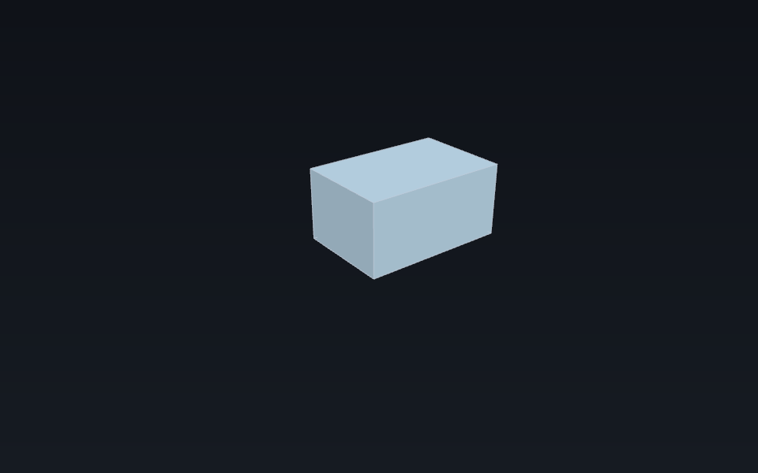

# Screenshots: generated viewport snapshots and manual app captures

Status: reference (2026-10-27). Companion to
[`../user/README.md`](../user/README.md) (the generated workflow pages),
[`../README.md`](../README.md) (the docs index) and
[`../viewport/render-diagnostics.md`](../viewport/render-diagnostics.md) (the render
trace knobs).

`tools/screenshot.py` has three scopes, and they answer different questions:

| Mode | Shows | Reproducible | Needs |
| --- | --- | --- | --- |
| `viewport` (default) | the 3D viewport only: tessellated shapes, camera, size, surface/edge colours | **Yes** — a spec plus the renderer gives the same PNG bytes | a wgpu adapter; no display and no window manager |
| `chrome` | the app window: title bar, header controls, navigation cube, action dock, status line, and with `--dev-tools` the Dev Tools window beside it | Mostly — the app is launched fresh, but the desktop's window manager can add its own frame | an X display (or Xvfb); X11 capture |
| `desktop` | the whole display, or a `--region` of it: the app plus the desktop and any other windows | No — it captures the live session | an X display with root capture; X11/Xvfb, not a Wayland-only session |

Use `viewport` for anything that should be reviewable in CI: it is a small JSON
spec, it renders through the same `Stage` → `WgpuRenderer` path as the window, and
the image gate is GPU-free. Use `chrome` when the *shell* is the point (the README
hero, a release note about the window). Use `desktop` only when the surrounding
session is genuinely part of the picture; it captures other windows too.

## The renderer

`crates/ferrocad_snapshot` is the small binary both Python tools invoke. It owns the
JSON boundary; the rendering itself is `ferrocad_wgpu::snapshot`:

```sh
ferrocad_snapshot <spec.json> <out.png>
ferrocad_snapshot --validate <spec.json>
```

`-` reads the spec from stdin or writes the PNG to stdout. Exit codes are `0` for
success, `2` for a usage/spec/I/O error, and `3` for “this machine has no usable GPU
adapter”. The renderer is kernel-free: the spec carries a mesh (or a box primitive),
not a BREP file, so the producer — the workflow process that owns the kernel —
tessellates first.

## The spec



*A generated snapshot: the spec below, rendered by `tools/screenshot.py`.*

```json
{
  "size": [960, 600],
  "camera": {
    "eye": [-120, -160, 120],
    "target": [10, 10, 5],
    "up": [0, 0, 1],
    "fov_y": 0.7
  },
  "shapes": [
    {"geometry": {"box": {"size": [60, 40, 30], "origin": [0, 0, 0]}},
     "color": [0.55, 0.75, 0.9, 1.0],
     "draw_mode": "shaded_with_edges"}
  ]
}
```

- `size` defaults to `[960, 600]`; `camera.eye` and `target` are required, `up`
  defaults to `+Z`, and `fov_y` is radians (about `0.6` by default).
- A shape is either `{"box": {"size": [...], "origin": [...]}}` or
  `{"mesh": {"positions": [...], "normals": [...], "triangles": [...],
  "edges": [...]}}`. Triangles are flat triples, edges flat pairs.
- Optional per-shape keys are `color` and `edge_color` (linear RGBA) and
  `draw_mode` (`shaded`, `wireframe`, `shaded_with_edges`). The default is
  `shaded_with_edges` with the theme's colours.
- Validation happens before any GPU work: a zero size, an empty shape, an
  out-of-range index or a camera with no view direction is a spec error, not a
  blank frame.

## The two CLIs

### `tools/screenshot.py`

**Viewport** — a one-off image outside the user-page pipeline:

```sh
python3 tools/screenshot.py --spec scene.json --out target/shots/scene.png
python3 tools/screenshot.py --spec scene.json --out target/shots/scene.png --size 1440x900
python3 tools/screenshot.py --workflow toy-workbench --out-dir target/shots
python3 tools/screenshot.py --list
```

`--workflow` runs one workflow and renders every `image` op that has a spec into
`--out-dir`. An image op without a spec is a hand-supplied illustration and is
skipped with a note. The tool builds `ferrocad_snapshot` with
`cargo build --offline -p ferrocad_snapshot`; `--snapshot-bin PATH` or
`FERROCAD_SNAPSHOT_BIN` uses an existing binary (the release/docs job can pass one).

**Chrome** — launch an edition and capture its window:

```sh
python3 tools/screenshot.py --mode chrome --edition toy --out shots/toy.png
python3 tools/screenshot.py --mode chrome --edition toy --size 1280x720 --out shots/toy.png
python3 tools/screenshot.py --mode chrome --edition parametric --open model.FCStd --out shots/part.png
python3 tools/screenshot.py --mode chrome --display :0 --title "FerroCAD" --wait 20 --out shots/app.png
```

The host needs `xwininfo` and `xwd` (Linux packages `x11-utils`/`x11-apps`). The
edition is built (`toy` by default; `base` and `parametric` are the others), or
`--app-bin PATH` uses a binary. The tool waits for a window whose title contains
`--title` (`FerroCAD` by default), optionally resizes it (needs `python-xlib`; the
app's 1180×760 default is used otherwise), waits for a frame and captures it with
`xwd`. The app is forced onto X11 (`WAYLAND_DISPLAY=`, `XDG_SESSION_TYPE=x11`) so the
capture path is the same on X11 and an Xwayland session. If `DISPLAY` is unset and
`Xvfb` is installed, the tool starts a private Xvfb for the capture and stops it
again. `--open` opens a document at boot.

The README hero is produced this way:

```sh
python3 tools/screenshot.py --mode chrome --edition toy --size 1280x720 --out screenshot.png
```

`--dev-tools` opens Dev Tools (`Ctrl+Shift+D`) after the window appears and
composes both windows into one PNG, which is how the shell-overview and
selection pages show the document tree beside the viewport:

```sh
python3 tools/screenshot.py --mode chrome --edition toy --dev-tools \
  --size 1280x720 --out docs/user/images/shell-overview.png
```

It needs `python-xlib` (to send the shortcut) and Pillow (to compose). The two
windows are captured separately at their own sizes, so a HiDPI X display produces
a Dev Tools column twice as tall as the app window; a nested 1× server keeps the
pair even:

```sh
Xephyr -screen 1920x1080x24 -ac -br -noreset :5 &
python3 tools/screenshot.py --mode chrome --display :5 --dev-tools \
  --edition toy --size 1280x720 --out docs/user/images/shell-overview.png
```

To capture a document a workflow builds, save it headlessly and open it; this is
how `toy-workbench-window.png` and `selection-and-commands-window.png` show the
objects the page discusses rather than the sample document:

```sh
target/debug/ferrocad_toy --stl /tmp/model.stl --script /tmp/make_model.py
python3 tools/screenshot.py --mode chrome --edition toy --open /tmp/model.ferrocad \
  --size 1280x720 --out docs/user/images/toy-workbench-window.png
```

### Which scope a user page uses

**Chrome is the default for shell-facing pages.** The tutorial's window, the toy
workbench, selection and commands, the grid toggle and the explanation page all
show the window, because the shell is part of what they teach.

**Viewport is kept where the geometry or a value is the subject.** `first-model`,
`documents-and-properties`, `parametric-recompute` and `undo-and-persistence`
picture a box whose size the workflow computed (105 mm, 30 mm, 25 mm), and the
shared sample document cannot show it. A chrome capture of a different document
would illustrate the wrong model, so those pages keep the offscreen rendering and
say so in the caption. The app-window screenshots on the shell-facing pages are
manual artefacts: they are not in the manifest and `--check` does not inspect
them.

**Desktop** — capture the display:

```sh
python3 tools/screenshot.py --mode desktop --out shots/desktop.png
python3 tools/screenshot.py --mode desktop --region 0,0,1920,1080 --out shots/desktop.png
```

On X11 this is a root-window capture (and needs an X11 display or Xvfb). On a
Wayland session it falls back to `grim` when that is installed, then to
`xdg-desktop-portal` through PyGObject, which may show a permission prompt. If
neither is available, the tool reports that and suggests `--mode chrome` instead of
producing a misleading image. Remember that a desktop capture includes every other
window.

### `tools/userdocs.py --capture`

Use it when the image belongs to a generated page. A workflow records the spec in
its `cap.image(...)` call:

```python
cap.image(
    "toy-slab.png",
    "the toy slab after the height grip and the move",
    "The `Wide` slab, from `stage_meshes()`.",
    mesh=wide,
    camera={"eye": [...], "target": [...], "up": [0, 0, 1]},
    size=[960, 600],
)
```

The page only reads the committed PNG; `--capture` renders the spec and writes the
file. `mesh=` is one item from the workflow's own `stage_meshes()` (or another
mapping with positions/triangles/edges); `shape=` accepts a `{"box": ...}` spec or a
kernel shape with `tessellate()`. See
[`../user/tutorials/first-model.md`](../user/tutorials/first-model.md) and
[`../user/how-to/toy-workbench.md`](../user/how-to/toy-workbench.md) for the two
working examples.

## Why `--check` is safe without a GPU

The manifest covers the **viewport** images produced by workflows. Chrome and
desktop captures are one-off artefacts: they are not reproducible enough to pin
(they depend on the window manager and the live desktop), so `--check` does not
inspect them and `--capture` never writes them.


`docs/user/images/manifest.json` records, per generated image, the SHA-256 of the
canonical render spec, the PNG byte digest, the size and the workflows that produce
it. `python3 tools/userdocs.py --check` compares:

- every `image` op with a spec has a manifest entry;
- the manifest's spec digest matches the workflow's current spec (a changed camera,
  shape or size fails even though the PNG cannot be re-rendered here);
- the committed PNG exists and its bytes match the manifest (a hand-edited or stale
  PNG fails);
- no manifest entry is left without a producing workflow.

`--capture` refreshes the images **and** the manifest. `--write-manifest` adopts a
set of already-rendered PNGs into the manifest without a GPU; it is the migration
path for a checkout that has images but no manifest. Neither `--check` nor the
normal page generation ever needs an adapter.

A capture on a machine without an adapter prints the reason and leaves both the
committed PNGs and the manifest untouched.

## Limits

- The viewport renderer draws the **stage** vocabulary only. It does not draw the
  shell, Dev Tools, the navigation cube, the grid overlay or selection
  highlighting; use `--mode chrome` for those.
- Chrome capture is X11-only (X11, Xwayland, Xvfb, CI). It can start Xvfb on a
  headless Linux machine, but the resulting frame has no window-manager title bar
  (the app's own client-side frame is still there).
- Desktop capture uses X11 root capture, then `grim`, then the portal. The portal
  may prompt and needs PyGObject; `grim` needs a wlroots-compatible compositor.
- Chrome/desktop capture is implemented for Linux today. The viewport renderer is
  cross-platform; a native Windows/macOS window capture is not wired yet.
- A mesh must already be tessellated by the producer; the renderer has no kernel and
  no BREP reader.
- The output is deterministic for a given spec and renderer build, not a promise
  that two renderer versions produce identical pixels. The manifest records the
  spec and the committed bytes; re-running `--capture` is what updates both.
- The feature is not on the CI path. `--capture` needs an adapter; the `--check`
  gate is the cheap, GPU-free guarantee that the committed images still match the
  workflows.
